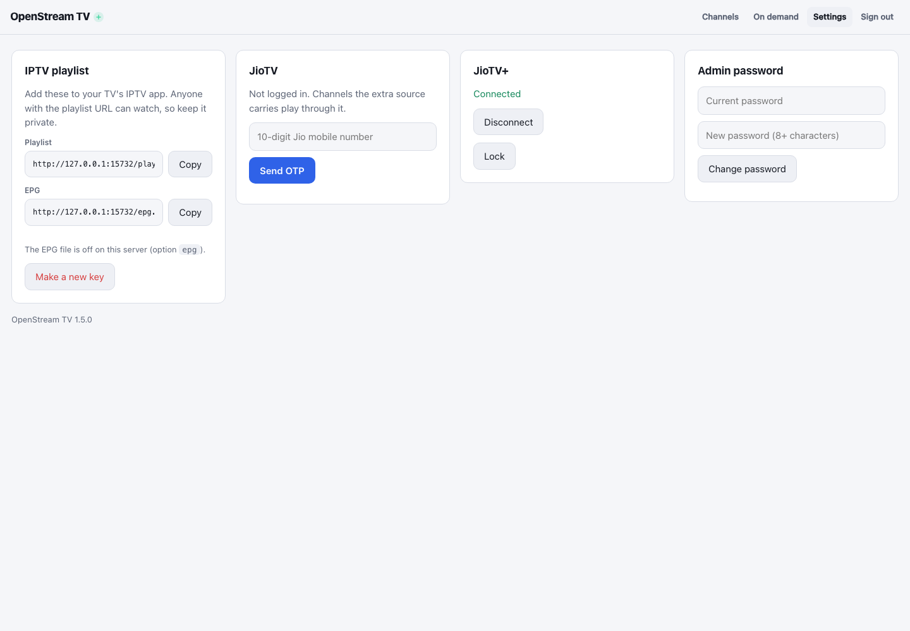

# Switch to Another JioTV Account

The server currently uses **one active JioTV provider account** at a time. There is no multi-account picker in the web interface. To use a different mobile number, sign out of the current JioTV connection and sign in again. Your **admin password** and optional **JioTV+ channels** connection are separate.

## Switch in Settings

1. Open **Settings** while signed into the OpenStream TV web interface.
2. In the **JioTV** card, select **Log out**, then confirm. This button appears for a connected account when provider logout is allowed. It is available by default unless an administrator sets `disable_logout = true` or `OPENSTREAM_DISABLE_LOGOUT=true`.
3. In the same card, enter the **new** account's mobile number and request an OTP.
4. Enter the OTP sent to that number to finish signing in.
5. Return to **Channels** and reload the channel list.

**Expected result:** Settings reports **Logged in** for the new provider account. The available channels and programme guide may change based on that account's plan. Existing playlist links may need refreshing after an account change.

The current Settings view below shows the JioTV sign-in form while JioTV+ is connected separately. It illustrates where to enter the replacement JioTV account; it does **not** show a completed switch.



## Switch using the CLI

If logout is disabled in Settings, or you manage a headless server, use the commands below. Stop OpenStream TV **before** changing the credentials so the running process does not overwrite the new state.

```sh
ost login reset
ost login otp
```

Both commands must run as the **same operating-system user and with the same configuration/data directory** used by the server. The first clears the JioTV login; the second prompts for the new number and OTP. Then restart OpenStream TV using your original command or service manager. For OpenWrt, follow its [service-management instructions](../maintenance-openwrt/index.md). For a Docker install, prefer the Settings workflow unless you know how to run commands against the container's persistent volume.

## If switching does not work

If the old account still appears, ensure you stopped the correct server and used its actual data directory. If the OTP fails, request a fresh one. If channels differ after login, the new account may have different entitlements; see [login troubleshooting](../troubleshooting-accounts-and-extras/index.md). Switching JioTV does not automatically reconnect or disconnect [JioTV+ channels](../account-extras/index.md).
