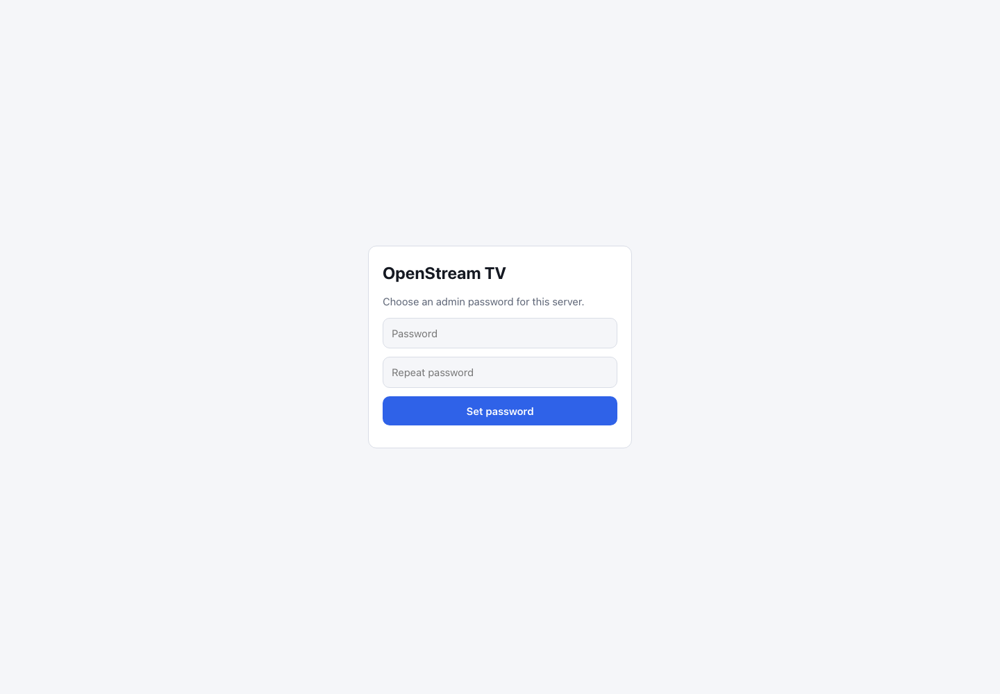

# First Launch and Admin Setup

This guide requires the **full** build, which includes the browser interface. The slim build supports IPTV clients only and has no web UI. OpenStream TV protects the admin interface with a password and its playlist routes with an access key. The **admin password** belongs to this local installation; your JioTV account has a separate OTP sign-in.

1. If guided setup already started the service, use its running address; do not start a second copy. Otherwise run `openstream serve` on the host in a terminal.
2. Look for **Web setup** in the server output or service logs. Open the full URL privately in your browser. The URL includes an access key.
3. Enter a password of eight or more characters, repeat it, then select **Set password**.
4. Return to the interface and verify that **Channels**, **On demand**, and **Settings** appear after sign-in.

This screenshot is the current v1.5.0 **Web setup** form from a fresh local data directory. The setup URL itself contains the server access key, so the browser address bar is intentionally not shown.

If you do not have the setup link, you can run `openstream admin password` in the server's terminal and set the password there. Store it safely. For a remote device, make sure you are opening the OpenStream TV host, not your viewing device's own localhost.

**Never post the setup link, access key or server data directory.** For more protection, read [Network access and HTTPS](../configuration-network-security/index.md). Next: [connect JioTV](../account-connect-jiotv/index.md).
