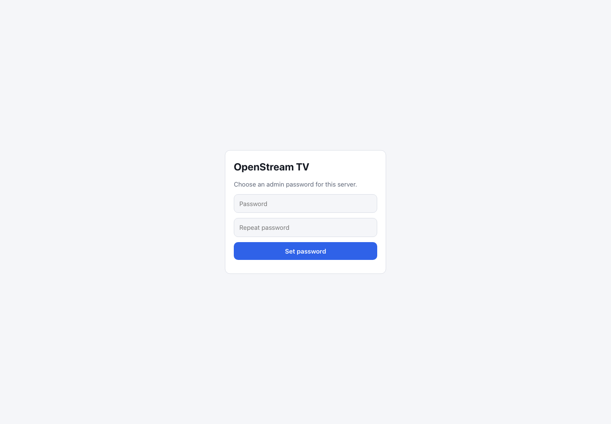
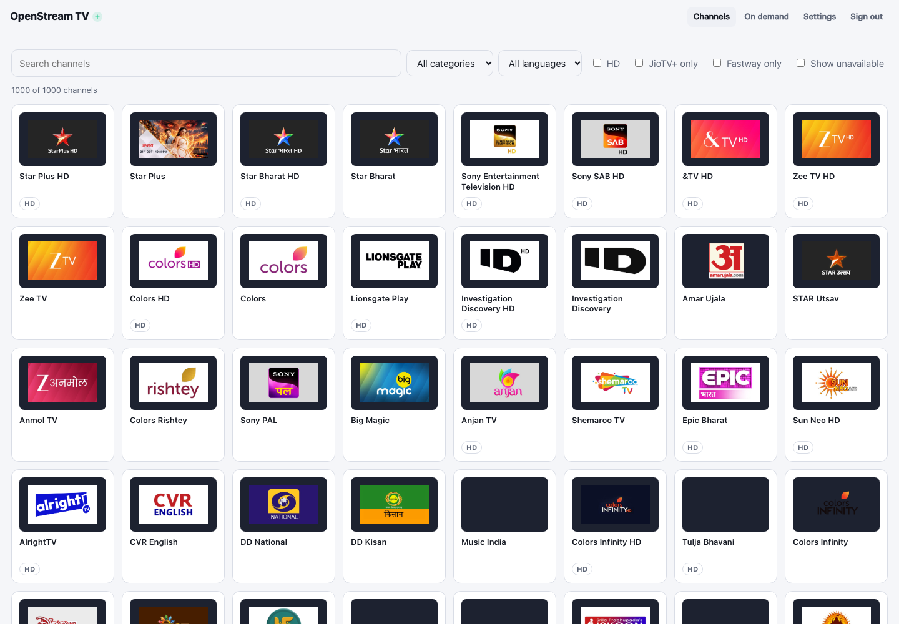

# ⚡ Getting Started in 5 Minutes

The shortest path from a fresh installation to watching live TV. You need the **full** build (the one with the browser interface — the slim build is for IPTV clients only), a provider account, and a machine that can run the server. Five minutes is the hands-on time; downloads and OTP delivery take as long as they take.

---

## 🧰 Before You Start

| You need | Why |
| :--- | :--- |
| The full build | Without it there is no web interface, only the playlist. |
| A provider account | JioTV, JioTV+, Fastway and the beta providers each have their own sign-in. |
| A browser on the same machine | The first-launch setup link only works locally. |
| Port 5001 free | That is the default HTTP port; `--port` changes it. |

---

## 📦 Step 1: Install

Pick your platform in [Installation](../installations/index.md). On Linux or macOS the repository installer is enough:

```sh
curl -fsSL https://raw.githubusercontent.com/wpfyorg/openstream-tv/main/scripts/install.sh | sh
```

Review the script before running it if that suits your security policy. Windows, OpenWrt, Termux and Docker each have their own article.

---

## 🚀 Step 2: Start the Server

If the guided installer already started the service, use the address it printed instead of starting a second copy. Otherwise:

```sh
ost serve
```

The server listens on **http://localhost:5001/** and stays running while you watch. On first launch it prints a private **Web setup** link in the terminal.

> [!IMPORTANT]
> Copy the whole setup link into a browser **on the server**. It contains your access key, so do not paste it into chat, screenshots or an issue.

Serving other devices on your network is covered in [Access from your network](../configuration-network-security/index.md).

---

## 🔑 Step 3: Choose an Admin Password

The setup page asks you to type and repeat an **admin password** of at least eight characters, then **Set password**. Use the same password to **Sign in** afterwards.

If you opened `/` before setting a password, the page points you back to the setup link — or run `ost admin password` on the server.



> [!NOTE]
> This password protects the web interface. It is not your provider account and never leaves your server. The screenshot shows the v1.5.0 form reached through the private setup link.

---

## 📲 Step 4: Connect a Provider

1. Open **Settings**.
2. Find the card for your provider — JioTV, JioTV+, Fastway, Airtel Xstream, Tata Play or PlayboxTV — and use its sign-in form.
3. Enter the OTP that arrives, or the username and password Fastway asks for.
4. The card changes to **Connected** / **Logged in**.

You can sign in to several providers. Only the **active** one supplies the channel list; switch it with the **Use …** button on the card or with `ost provider use <provider>`.

> [!IMPORTANT]
> JioTV+, PlayboxTV, Airtel Xstream and Tata Play are disabled by default, and their sign-in endpoints reject requests until they are enabled. Add `tv_plus = true`, `playbox = true`, `airtel = true` or `tataplay = true` to your config file (or start the server with `OPENSTREAM_TVPLUS=true`, `OPENSTREAM_PLAYBOX=true`, `OPENSTREAM_AIRTEL=true` or `OPENSTREAM_TATAPLAY=true`) and restart it. Their OTP sign-in then works, and their cards appear in Settings. On an installed service, an `OPENSTREAM_*` value in the service environment overrides the config file, so set that value to `true` or remove it, then restart the service. See [server configuration](../configuration-reference/index.md) for the file location and every option.

| Situation | Where to go |
| :--- | :--- |
| JioTV number and OTP | [Connect JioTV](../account-connect-jiotv/index.md) |
| JioFiber / AirFiber account | [JioTV+](../account-extras/index.md) |
| Fastway username and password | [Fastway](../account-fastway/index.md) |
| No OTP arrives | [Fix OTP login](../fix-otp-login/index.md) |

---

## 📺 Step 5: Watch a Channel

1. Choose **Channels** in the navigation.
2. Narrow the list with **Search channels**, **Category**, **Language**, or the **HD** filter.
3. Select a tile — the live player opens.
4. Use the player controls for pause, volume, quality and full screen.



> [!NOTE]
> The screenshot is a v1.5.0 JioTV+ session. It shows the layout and catalogue rendering; it does not promise that every listed channel plays on every account.

---

## 🧾 Step 6: Add It to Your TV (Optional)

Settings lists the two URLs to paste into any IPTV app:

The guide URL returns HTTP 503 until EPG is enabled and the guide file is ready. Enable it with `ost epg on` before copying it. If you started the server in the foreground with `ost serve`, restart it afterwards; the command prints the same reminder when it cannot restart an installed service.

| File | Where |
| :--- | :--- |
| Playlist | `http://<server>:5001/k/<key>/playlist.m3u` |
| Guide | `http://<server>:5001/k/<key>/epg.xml.gz` |

Copy the complete URLs from Settings rather than typing them: the `/k/<key>/` segment is what authorises the request, and the bare paths return HTTP 401 when authentication is on. If authentication is deliberately disabled, Settings shows the unkeyed `/playlist.m3u` and `/epg.xml.gz` paths instead.

> [!CAUTION]
> Anyone with the playlist URL can watch. Keep it private. If it leaks, rotate it from Settings, which updates the running server immediately. `ost key rotate` from a shell only writes the new key to the store, so restart the server afterwards. When authentication is disabled, rotation does not revoke the unkeyed `/playlist.m3u` URL; restore authentication or restrict network access instead.

More: [using IPTV playlists](../using-iptv-playlists/index.md).

---

## 🔧 If Something Is Off

| Symptom | First thing to try |
| :--- | :--- |
| Page asks for a setup link | Use the link printed in the terminal, or `ost admin password`. |
| No channels listed | Settings → check the provider says connected, then switch to it. |
| Channel says subscription required | Confirm the channel plays in the provider's own app with the same account. |
| Player shows a DRM error | Serve the UI over HTTPS with `ost serve --tls`. |

Full list: [Troubleshooting](../troubleshooting/index.md) · [Channels and playback](../troubleshooting-channels-and-playback/index.md).
